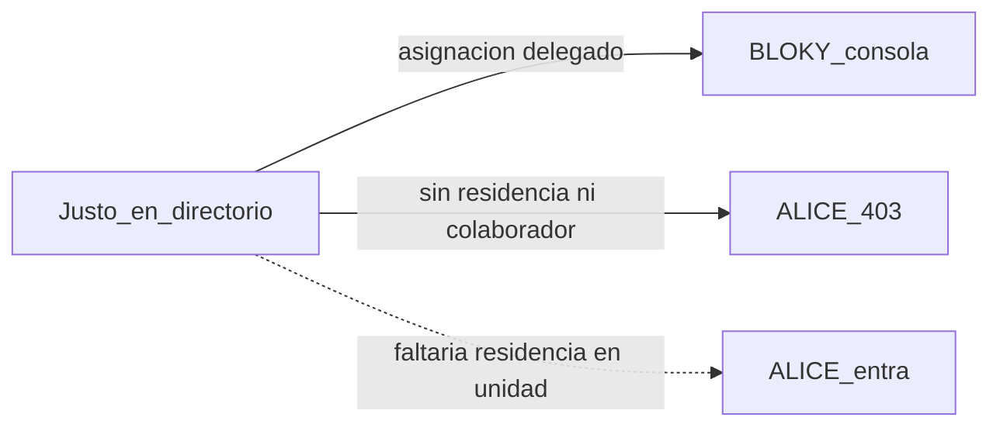

# 21 — El Delegado entra a BLOKY y ALICE lo trata como externo

> **Quién lo abre:** Justo (2026-11-15), al probar el login de ALICE por celular + WhatsApp (T-132).
> **Para:** Daniel (decisión de producto).
> **Hechos comprobados en Dev** el 2026-11-15 contra el directorio real.

## Qué pasó

Justo Soto (CC `80821419`, celular `3053996759`):

| En | Resultado |
|---|---|
| **BLOKY** (`bloky-dev.idiky.com`) | Entra a **Pruebas IDIKY** como **Delegado**. Crea/ve reuniones; aparece como **suplente del anfitrión**. |
| **ALICE** (Flutter) | `POST /api/app/acceso/enviar-codigo` responde **`403 sin_acceso`**: «Tu registro existe, pero hoy no tienes acceso a ninguna unidad.» |

Consulta al directorio (misma persona):

- 1 asignación: **`delegado` vigente** en Pruebas IDIKY (`origen=idiky`).
- **Ninguna** residencia en una unidad (`administrador` / `residente` / `invitado`).
- **Ninguna** asignación `colaborador`.

El celular y la cédula están bien. No es un dato mal cargado: el middleware hace exactamente lo que dice RN-327.

## Por qué el código hace eso

ADR-0032 / RN-327 separan dos puertas:

| App | Quién entra | Rol en el directorio |
|---|---|---|
| **BLOKY** (consola web) | Administrador y Delegado | `administrador`, `delegado` |
| **ALICE** (app del residente) | Residentes y colaboradores | `residente` (+ residencia en unidad) o `colaborador` |

En el middleware (`alice/rutas.ts`), antes de mandar el código, `lugaresDe` solo cuenta:

- residencias vigentes en unidades, o
- asignación `colaborador` vigente,

en copropiedades activas / en implementación. **Delegado y Administrador no cuentan.** Por eso la persona “existe” (no es `404`) pero “no tiene unidad” (`403`).

Texto del ADR-0032 §6: *«Administrador y Delegado siguen entrando a BLOKY»* — no dice que entren a ALICE.

## Por qué se siente ilógico (el hueco de producto)

En la práctica, el mismo humano:

1. En BLOKY **programa reuniones**, es **anfitrión o suplente**, y opera la copropiedad.
2. En ALICE debería poder **entrar a la videoconferencia** y, más adelante, **votar en cadena**.

Hoy eso exige un **segundo vínculo**: que alguien lo cree también como residente de una unidad (o colaborador). Sin ese vínculo, ALICE lo ve como si no perteneciera al lugar, aunque en BLOKY sea quien lo administra.

No es que “parezca una persona externa” por error de datos: **son dos roles distintos en el modelo**, y solo uno abre cada app.

## Qué no hay que confundir

- **Ser suplente en una reunión** (dato de la reunión en BLOKY) ≠ **tener unidad en ALICE**.
- **Asignación Delegado** (quién administra el cliente en BLOKY) ≠ **residencia** (quién vive / gestiona una unidad en ALICE).
- El mensaje de la app es fiel al contrato de [docs/20](./20-alta-e-ingreso-desde-alice.md); cambiar el mensaje sin cambiar la regla solo ocultaría el hueco.

## Decisión que pide Justo (para Daniel)

¿Quién más debe poder abrir ALICE además de residente/colaborador?

| Opción | Efecto |
|---|---|
| **A. Mantener RN-327** | Administrador/Delegado solo BLOKY. Para probar ALICE hay que darles también una residencia (o ser colaborador). |
| **B. Ampliar RN-327** | Administrador y Delegado vigentes también entran a ALICE; `lugares` trae la copropiedad con un rol de administración (sin unidad, o con un “lugar” de consola). Hay que definir qué ven (¿reuniones sí, votación de unidad no?). |
| **C. Puente automático** | Al asignar Administrador/Delegado, BLOKY crea además una residencia o un “acceso ALICE” explícito. |

Hasta que Daniel elija, Justo **no cambia** el middleware a ciegas (aviso 6 / ADR-0032).

## Workaround de prueba (sin cambiar la regla)

En BLOKY → **Unidades** → crear administrador de una unidad con el celular `3053996759`. Entonces el mismo Justo tendrá:

- Delegado → BLOKY  
- Residencia en unidad → ALICE + WhatsApp  

## Referencias

- ADR-0032 §6 · RN-327 · [docs/20](./20-alta-e-ingreso-desde-alice.md)  
- Middleware: `Bloky-Idiky/apps/bloky-api/src/alice/rutas.ts` (`lugaresDe`, `ROLES_DE_ALICE`)  
- Caso real Dev: 2026-11-15, Pruebas IDIKY, Justo Soto  
