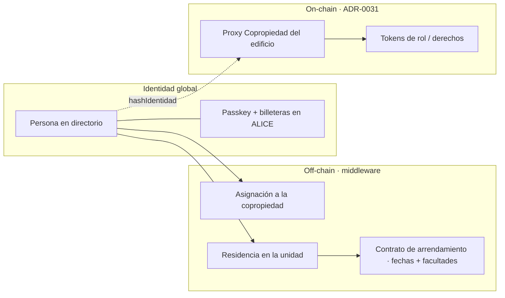
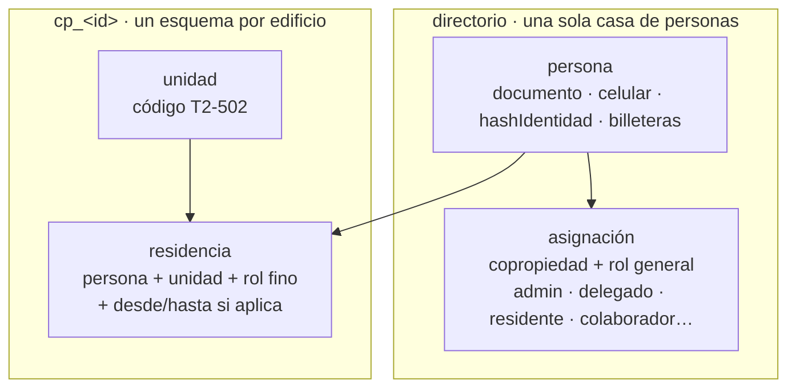
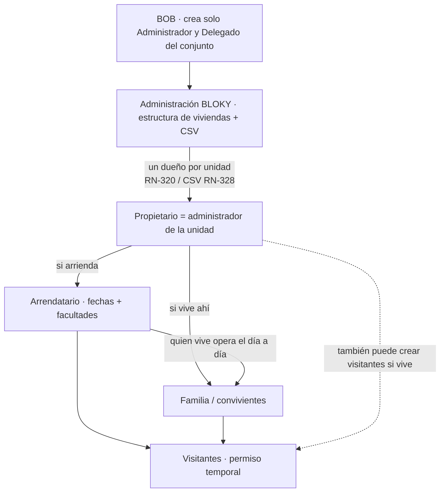
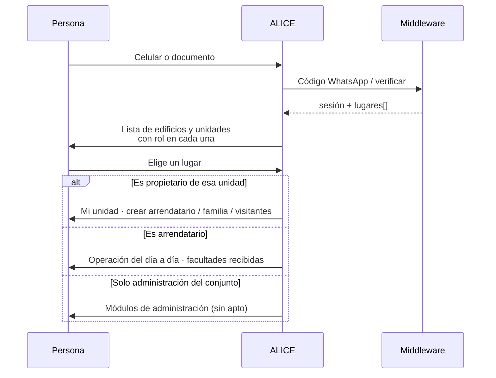
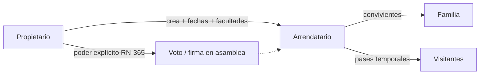
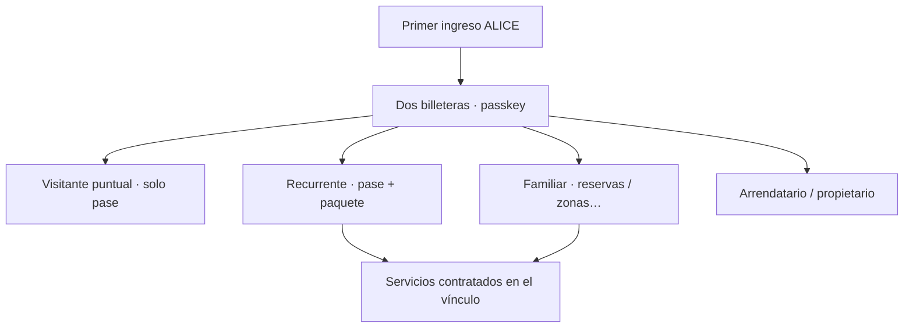
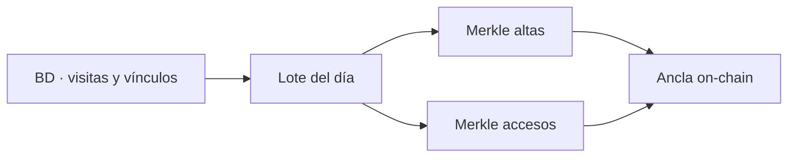

# 23 — Propietario, arrendatario y vínculos con la vivienda

> **Estado:** 🟡 **respondido por Daniel** (2026-11-23): D1, D2, D4, D5 y D6 aprobadas; D3 con ajuste (paquetes como roles fijos
> de BOB, RN-366); D7 y D8 en principio, como ADR aparte. Reglas: **RN-366 a RN-369**. Ver la respuesta en [`avisos/daniel.md`](./avisos/daniel.md) §12. Borrador de producto; **aún no es ADR**.
> Cuando Daniel lo autorice (o lo ajuste), se convierte en ADR + reglas (`RN-…`) y se actualizan
> [docs/20](./20-alta-e-ingreso-desde-alice.md) y [ADR-0032](./adr/0032-residentes-colaboradores-e-ingreso-de-alice.md).
>
> **Para qué sirve:** visión de cómo una persona se asocia a una vivienda, quién crea a quién, qué ve ALICE,
> arrendatario / familia / visitantes, billeteras, bitácora Merkle y tokens on-chain.
>
> **Relacionados:** ADR-0025 · ADR-0031 · ADR-0032 · ADR-0034 · docs/20 · RN-320, RN-321, RN-326, RN-328, RN-365 · T-127  
> **Aviso a Daniel:** [`avisos/daniel.md`](./avisos/daniel.md) §12 · **Este documento ya está en `main`.**

---

## 0. Idea central (una frase)

La Administración del conjunto carga a los **propietarios** de cada unidad (CSV). El propietario **no tiene que vivir ahí**:
registra a quien vive (arrendatario, familia) y les pasa facultades. Quien vive opera el día a día (visitantes, convivientes).
ALICE siempre muestra **todos los lugares** donde esa persona tiene vínculo. **Todo usuario de ALICE** activa passkey y
**dos billeteras** en el primer ingreso; lo que cambia por vínculo es el **paquete de permisos/servicios**, no las carteras.

---

## 1. Tres “contratos” que no se deben mezclar

| Nombre | Qué es | ¿Lo ve la persona en el login? |
|---|---|---|
| **Vínculo / residencia** | Persona ↔ **unidad** (propietario, arrendatario, residente, invitado…) | **Sí:** listado `lugares` |
| **Contrato de arrendamiento** | Fechas y **facultades** que el dueño le da al arrendatario | Dentro de la unidad (Mi unidad), no al pedir el código |
| **Proxy on-chain `Copropiedad`** ([ADR-0031](./adr/0031-un-contrato-por-copropiedad.md)) | Derechos del **edificio** (tokens de rol, votaciones…). Sin PII | Tras bambalinas; no es un menú “abre el contrato” |

La **cartera / pagos** de una unidad es otro módulo (`pagos`): se abre cuando la persona entra a esa unidad con permiso.
No sustituye al listado de vínculos.

---

## 2. Capas de datos (cómo se asocia persona ↔ vivienda)

| Capa | Responde a |
|---|---|
| **Persona** | ¿Quién es en todo IDIKY? (un documento = una persona) |
| **Asignación** | ¿En qué **edificios** aparece y con qué rol de conjunto? |
| **Residencia** | ¿En qué **apartamento/casa** y con qué rol fino? |
| **`lugares` en `/yo`** | Lo que ALICE muestra: la unión vigente de lo anterior (RN-326) |

**Admin del conjunto ≠ vive ahí.** El Administrador / Delegado puede tener `administracion` en un lugar **sin** unidades.
Eso ya está pensado; no hace falta preguntarle en el login “¿eres residente?”.

---

## 3. Cadena de quién crea a quién

### Reglas de la cadena

1. **La Administración no inventa arrendatarios ni familiares** de cada apto: carga al **propietario**.
2. El propietario registra **quién vive** y con qué facultades.
3. Al crear un **arrendatario**, el dueño **pasa la operación del día a día** a quien habita (visitantes, convivientes, etc.).
4. **No hay auto-reclamo** de apartamento vacío en el primer login (“yo vivo en el 502” → dueño automático). Eso sería un hueco de seguridad. Si algún día se necesita menos carga para la Administración: **CSV**, **invitación acotada** o **solicitud pendiente de aprobación** — no mint automático de propietario.

---

## 4. Roles en la unidad (visión de producto)

Nombres que queremos usar en ALICE (hoy en API el dueño se llama `administrador` de la unidad):

| Rol en la unidad | Quién lo crea | ¿Vive ahí? | Qué puede (visión) |
|---|---|---|---|
| **Propietario** (admin. de la unidad) | Administración (CSV / alta) | Opcional | Crear arrendatario, familia, visitantes; decidir facultades; es quien vota salvo poder (RN-365) |
| **Arrendatario** | Propietario | Sí (en el periodo del contrato) | Casi la operación del dueño **según facultades**; gestiona visitantes y convivientes |
| **Residente / familiar** | Propietario o arrendatario (si tiene facultad) | Sí | Vivir; visitantes si se le permite; no es dueño ni asume el paquete completo del arrendatario |
| **Visitante puntual** | Quien vive con facultad | Horas / un día | App + billeteras; solo pase/portería |
| **Visitante recurrente** | Quien vive con facultad | Regla recurrente o días | App + billeteras; servicios si el paquete los incluye |
| **Familiar** (hoy `residente` / antes “invitado” de días en API) | Propietario o arrendatario con facultad | Sí / o ventana de días | App + billeteras; zonas según paquete |

> **Hueco actual:** en BLOKY/ALICE la residencia solo tiene `administrador | residente | invitado`.  
> Faltan **arrendatario** (fechas + facultades) y el modelo fino de **visitante puntual/recurrente** — cerrar con Daniel (y Mary en voto, RN-365).

---

## 5. Qué ve la persona al entrar a ALICE

Siempre (no solo el primer ingreso): tras validar el código, `/yo` trae **todos** los vínculos vigentes.

Ejemplo de lectura humana del listado:

| Lugar | Etiqueta | Qué hace al entrar |
|---|---|---|
| Conjunto La Pradera · T2-502 | **Propietario** | Mi unidad: crear arrendatario / familia; cartera de esa unidad |
| Edificio Torres · Casa 14 | **Arrendatario** (vigente hasta …) | Opera el día a día según facultades |
| Oficina IDIKY · — | **Administración · Delegado** | Sin unidad; rol de conjunto |
| Otro conjunto · — | **Colaborador · Seguridad** | Portería / turno |

### Primer ingreso (identidad)

Independiente del rol en la unidad. Quien ya fue dado de alta (por CSV o por un propietario):

1. WhatsApp → 2. Confirmar documento → 3. Correo OTP → 4. Nombre + fecha nacimiento → 5. Passkey → billeteras.

**No** se pregunta “¿eres residente de este edificio?” ni “¿qué apartamento?”: el vínculo ya vino de la cadena de alta.

---

## 6. Crear arrendatario (visión de pantalla)

El **propietario**, en Mi unidad:

| Campo | Obligatorio | Notas |
|---|---|---|
| Nombre | Sí | |
| Celular (+ país) | Sí | Un celular = una persona |
| Tipo y número de documento (+ país) | Sí | Un documento = una persona; revisión RN-354 |
| Fecha inicio del arrendamiento | Sí | |
| Fecha fin del arrendamiento | Sí | Al vencer, el vínculo deja de estar vigente (como el invitado) |
| **Facultades** | Sí (paquete) | Ver §6.1 |

Luego el arrendatario hace el **mismo primer ingreso** y crea sus llaves en el teléfono.

### 6.1 Facultades que el dueño puede ceder

Borrador de paquete (ajustable con Daniel/Mary):

| Facultad | Efecto |
|---|---|
| Solo vivir | Entra a ALICE; no crea gente; no firma |
| Gestionar convivientes | Puede dar de alta familia que vive con él |
| Gestionar visitantes | Crea pases / visitantes |
| Entrar a reuniones | Ve módulo reuniones |
| Firmar / actuar con poder | Reuniones o asamblea **solo si** hay poder (RN-365): el arrendatario **no vota por ser arrendatario** |
| Pagos / estado de cuenta | Ver o gestionar cartera de la unidad (según matriz) |

Al “crear arrendatario con facultades amplias”, el dueño **delega la operación** de esa vivienda a quien vive, **sin ceder la propiedad** ni el voto por defecto.

---

## 7. Escalones de identidad: visitante → recurrente → familiar → residente

Acuerdo de producto (Justo, 2026-11-23; afinado el mismo día): **todos los que usan ALICE activan las dos
billeteras** en el primer ingreso (passkey / huella o factor del teléfono). El costo es el mismo chequeo que ya
hacemos para firmar el alta; **no aporta mucho posponerlas** por tipo de vínculo. Aunque el visitante puntual
casi no las use, quedan listas para el siguiente edificio o cuando suba de escalón.

Lo que **sí** se escala por vínculo es el **paquete de permisos / servicios**, no la existencia de las carteras.

| Escalón | App + doble cartera | Qué puede (visión) |
|---|---|---|
| **Visitante puntual** | Sí (primer ingreso completo) | Solo ingreso autorizado (horas / un día); QR/pase desde la app |
| **Visitante recurrente** | Sí | Reglas de recurrencia; servicios (gimnasio, piscina…) si el paquete los incluye |
| **Familiar / conviviente** | Sí | Vive; visitantes si tiene facultad; zonas/reservas según permisos |
| **Arrendatario / propietario** | Sí | Operación completa según rol y facultades |

### 7.1 Cuadrar permisos y “contratar” servicios

Al crear o editar el vínculo (familiar, recurrente, arrendatario), quien autoriza **configura el paquete**:

- solo acceso / portería;
- zonas comunes (gimnasio, piscina, …) → módulo `reservas` u otro;
- gestionar visitantes;
- reuniones / poder (solo con poder explícito, RN-365).

Eso se traduce a **permisos de la matriz** (ADR-0034) + vigencia del vínculo. No es un mint distinto por servicio:
es el mismo usuario (ya con billeteras) con más o menos módulos abiertos en ese edificio.

### 7.2 Visitante puntual vs recurrente

> **2026-11-26 (llamada Justo ↔ Daniel → RN-398):** al crear el invitado se elige la **relación** (trabajador, ayudante,
> familiar, …), si hay **horas**, y si es **una sola vez** o **recurrente** (p. ej. semanal por meses). Misma persona que el
> habitante (ALICE). **Por construir** (T-169). Familia/conviviente: condición etaria y control de salida → **RN-399**.

| | **Visitante puntual** | **Visitante recurrente / invitado** |
|---|---|---|
| Vigencia | Horas o un día | Días, semanas o regla recurrente |
| Billeteras | Sí (mismo primer ingreso) | Sí |
| Portería | Pase / QR desde ALICE | Igual + puede usar más módulos si el paquete lo dice |
| Quién lo crea | Quien vive con facultad `visitantes: crear` | Igual; el paquete lo define quien crea |

---

## 7b. Bitácora auditable (portería e ingresos) + ancla Merkle

**Operación en base de datos** (middleware): cada autorización y cada ingreso (portería / acceso a la unidad)
guarda *quién entró, quién autorizó, unidad, vigencia, resultado*.

**Cadena:** no un token por visita. Periódicamente (p. ej. **cierre diario** o por turno) se publica en el
proxy `Copropiedad` (o contrato de bitácora) la **raíz Merkle** del lote — sin PII (RN-298). Sirve de
notario: la bitácora off-chain se puede demostrar íntegra después.

Árboles sugeridos en el mismo cierre (o dos raíces):

1. **Vínculos / altas** — quién montó a quién ese día.
2. **Accesos** — quién pasó portería (o ingreso registrado) y con qué autorización.

Los **tokens de rol** del ADR-0031 siguen para derechos **estables** (propietario, admin del conjunto…).
La visita no hace mint por evento: vive en BD + pase firmado (patrón reuniones) + ancla Merkle del lote.
La persona **sí** tiene billeteras (primer ingreso); eso no implica token ERC-1155 de visitante.

---

## 8. Una persona, varios roles, varios edificios

Caso típico que debe funcionar sin fricción:

- Justo es **propietario** en La Pradera · T2-502 (no vive ahí; tiene arrendatario).
- Justo **vive** como residente/familiar en otro conjunto.
- Justo es **Delegado** de un tercer edificio (no tiene unidad ahí).

Un solo login → un listado → elige contexto. Bloquearlo en un apto **no** lo saca de los demás (RN-324).

---

## 9. Qué ya está construido vs qué falta

| Pieza | Estado |
|---|---|
| Admin/Delegado desde BOB | Hecho (ADR-0025) |
| Estructura de unidades + CSV del primer vínculo | Hecho (RN-318…328) |
| Primer vínculo = administrador de la unidad | Hecho; en producto = **propietario** (RN-365) |
| `lugares` al login | Hecho (docs/20 §4) |
| Matriz de permisos por módulo | Hecho (docs/20 §4b, ADR-0034) |
| Crear residente / invitado desde API | Hecho (docs/20 §5); falta UI completa en ALICE (Mi unidad) |
| Rol **arrendatario** + fechas de contrato | **Falta** |
| Paquete de **facultades** al crear arrendatario | **Falta** (encaja con matriz + poder) |
| Etiqueta “Propietario” en `lugares` | **Falta** (hoy `administrador`) |
| Visitante en app (todos con billeteras; paquete de servicios por vínculo) | **Falta** |
| Bitácora portería/ingresos + cierre Merkle diario | **Falta** (visión §7b) |
| Paquete de servicios (gimnasio/piscina) al crear familiar/recurrente | **Falta** (matriz + reservas) |
| Auto-registro “reclamo mi apto” | **Fuera de alcance** (salvo invitación o solicitud aprobada, futuro) |

---

## 10. Orden sugerido de trabajo (después de autorizar)

1. **ADR** a partir de este docs/23 (Daniel + Justo; Mary en voto/arrendatario si hace falta).
2. **ALICE · Mi unidad** contra la API actual (residente / invitado) — valor inmediato, no bloquea el ADR.
3. Middleware: rol `arrendatario` + fechas + facultades → permisos.
4. Visitantes en app (pase); paquetes de servicios; bitácora + cierre Merkle.

---

## 10b. Qué se pide autorizar a Daniel

Marcar ✅ / ajustar / rechazar. Detalle en §12.

| # | Decisión | Propuesta de Justo |
|---|---|---|
| D1 | Cadena de altas | CSV → propietario → arrendatario/familia/visitantes; sin auto-reclamo de apto |
| D2 | Propietario ≠ vive ahí | El dueño puede no residir; opera o delega al arrendatario |
| D3 | Arrendatario | Rol propio con fechas + paquete de facultades |
| D4 | Visitantes usan ALICE | Identidad en app; embudo multi-conjunto |
| D5 | Doble cartera | **Todos** la activan en el primer ingreso (passkey) |
| D6 | Qué escala | El **paquete** (pase / zonas / operar), no las billeteras |
| D7 | Cadena vs BD | Operación en BD; **Merkle periódico** de altas y accesos; tokens on-chain solo roles estables |
| D8 | Bitácora | Portería e ingresos a unidad auditables + ancla on-chain sin PII |

---

## 11. Glosario rápido de este documento

| Término | Significado aquí |
|---|---|
| **Propietario** | Quien la Administración cargó como administrador de la unidad; dueño del vínculo |
| **Administrador de la unidad** | Nombre técnico actual en API/ADR-0032 del propietario |
| **Administrador del conjunto** | Perfil raíz de BLOKY/BOB; puede no vivir en el edificio |
| **Arrendatario** | Quien vive con contrato de fechas y facultades cedidas por el propietario |
| **Residencia** | Fila persona+unidad+rol en el esquema del edificio |
| **Asignación** | Fila persona+copropiedad+rol en el directorio |
| **Pase de visita** | Permiso temporal de acceso (horas/días/recurrente); distinto de residencia |
| **Doble cartera** | Las dos billeteras (transaccional + financiera); **todos** las activan en el primer ingreso ALICE |
| **Cierre Merkle** | Ancla periódica on-chain del lote de altas y/o accesos; bitácora auditable sin PII |

---

## 12. Notas abiertas (para ir rellenando)

> Espacio para Justo / Daniel / Mary. Ir tachando o ampliando.

- [x] ~~Visitante en app + BD/Merkle en vez de mint por visita~~ — acordado 2026-11-23 (§7, §7b)
- [x] ~~Doble cartera para todos en el primer ingreso~~ — afinado 2026-11-23 (§7); el paquete de servicios es lo que escala
- [ ] ¿Las facultades del arrendatario son checkboxes fijos o reutilizan solo la matriz ADR-0034?
- [ ] ¿Un apto puede tener **varios propietarios** (copropiedad del inmueble)? ¿Quién “manda” al crear arrendatario?
- [ ] Al vencer el arrendamiento: ¿auto-finaliza residencias de familia/visitantes que creó el arrendatario?
- [ ] ¿El propietario no residente sigue viendo cartera y puede bloquear al arrendatario en cualquier momento?
- [ ] Visitante recurrente: ¿la regla (lun–vie 8–18, etc.) vive solo en middleware?
- [ ] Nombre en UI: ¿“Administrador de la unidad” o solo “Propietario”?
- [ ] Invitación por código / solicitud de vínculo: ¿sí en v1 o después del CSV?
- [ ] Cierre Merkle: ¿diario fijo, por turno de portería, o al cerrar el día en BLOKY?

---

*Última actualización: 2026-11-23 · Justo · **listo para revisión de Daniel** (avisos/daniel.md §12). No construir roles nuevos en contra hasta que lo autorice.*
